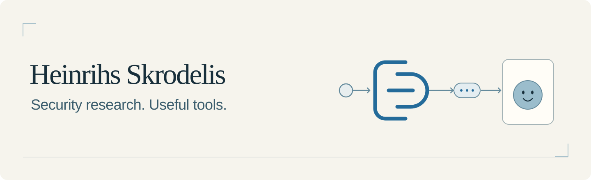
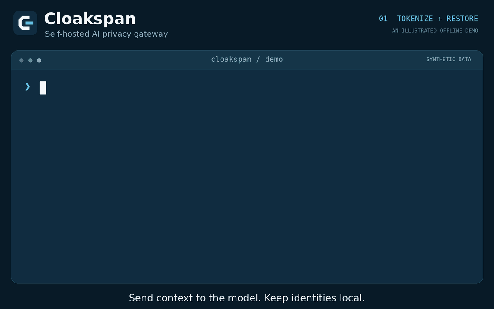
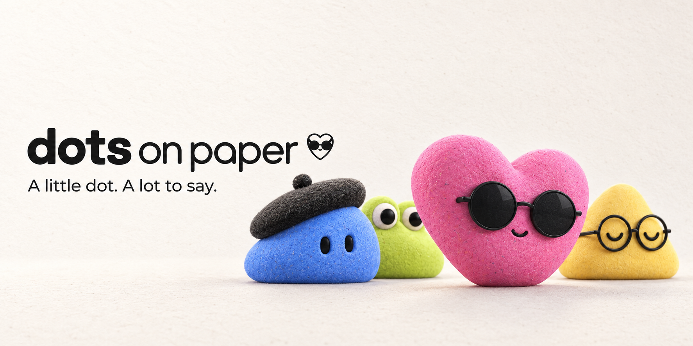

I'm a cybersecurity researcher and builder in Latvia. I build privacy tools for AI, little interfaces with personality, and security research for industrial systems.

Building in public on **[X / @heinrihs_s](https://x.com/heinrihs_s)** — experiments, progress and the bits that break along the way.

[Website & CV](https://heinrihs.org) · [securIT](https://securit.lv) · **[Play with a dot →](https://heinrihs.org/dotsonpaper/#demo)**

## What I'm building

### [CloakSpan](https://github.com/quiethours-eu/cloakspan)

**Give AI the context. Keep identities local.**

A self-hosted privacy gateway for AI workflows. Detect sensitive values, apply policy, send scoped tokens to the model, and restore approved values in the reply. Some requests belong on a local model; others should be blocked before they leave.

[Explore the code](https://github.com/quiethours-eu/cloakspan) · [Try the local playground](https://github.com/quiethours-eu/cloakspan#try-it-locally) · [How it works](https://github.com/quiethours-eu/cloakspan#why-it-exists)

<b>Watch what the model actually sees</b>

The demo uses synthetic data and a deterministic mock provider. CloakSpan is an alpha for local evaluation and synthetic-data pilots.

### [Dots on Paper](https://github.com/heinrihs-s/dots-on-paper)

**Give your assistant a little desk space.**

An open-source MCP and Home Assistant bridge that puts assistant replies on e-ink. Four companions, readable answers, and a little presence that stays on your desk after the chat window closes.

**[Try the interactive demo →](https://heinrihs.org/dotsonpaper/#demo)** · [Build your own](https://github.com/heinrihs-s/dots-on-paper#run-the-bridge) · [Explore the code](https://github.com/heinrihs-s/dots-on-paper)

<b>Meet the dots: Artist, Curious, Bookish & Cool</b>

Open the demo, switch companions, pick an example and replay the thinking state. A browser preview of the idea; the repository contains the bridge and rendering tools.

## The research behind the builds

My security work focuses on SCADA/ICS, protocol-aware detection and AI-agent safety. I like small, reproducible artifacts and explanations a tired human can still review.

- **[SCADA Agent SafetyBench](https://github.com/heinrihs-s/Scada-Agent-SafetyBench)** — simulation-only evaluation of AI assistants in SCADA / IEC-104 workflows.
- **[CTF writeups](https://github.com/heinrihs-s/CTF-writeups)** — challenge notes, including the SANS European Championship 2026.
- **[CVE-2026-62972 / BACnet Stack](https://github.com/bacnet-stack/bacnet-stack/security/advisories/GHSA-9hq3-w3pc-8385)** — reported an out-of-bounds read in the lighting command decoder; credited as reporter.
- **[OpENer / EtherNet/IP](https://github.com/EIPStackGroup/OpENer/issues/576#issuecomment-4667180658)** — independent report merged into the response-side buffer overflow investigation, with AFL++ / ASAN reproduction and capacity guards.

<b>Open the rest of the lab notebook</b>

- [IEC-104 Threat Scenario Generator](https://github.com/heinrihs-s/IEC-60870-5-104-Threat-Scenario-Generator) — synthetic scenarios and offline artifacts for IDS evaluation.
- [IEC-104 Rulebook](https://github.com/heinrihs-s/iec104-rulebook) — YAML monitoring rules and baseline templates.
- [Zeek IEC-104 Lab](https://github.com/heinrihs-s/zeek-iec104-lab) — synthetic records and helper scripts for detection experiments.
- [LogSpotAI](https://github.com/heinrihs-s/LogSpotAI) — a small OpenAI-assisted log review experiment.

---

If you're building with CloakSpan or Dots on Paper, I'd like to see what you make. Follow the builds on **[X](https://x.com/heinrihs_s)** or bring a concrete idea to the project's issues.
